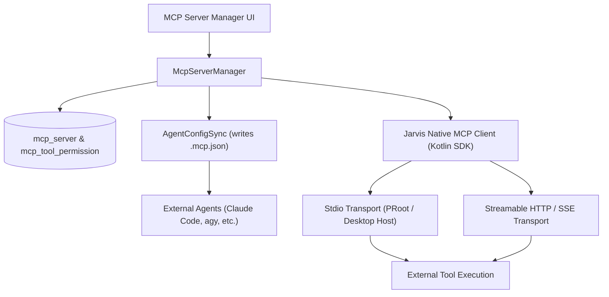

# 07 — Model Context Protocol (MCP) & Agent Skills

> This document defines how MindSparQ Jarvis integrates external capabilities via the Model Context Protocol (MCP) and the Agent Skills standard on both Mobile (Android/PRoot) and PC Desktop (Linux/Windows/macOS).

---

## 1. Dual-Layer MCP Architecture

Jarvis supports MCP at two distinct layers:

1. **Native Client Layer (`ai/mcp`)**: Jarvis itself runs an official Kotlin MCP Client (`io.modelcontextprotocol:kotlin-sdk`). When the built-in Jarvis Native Agent runs, it queries configured MCP servers, injects tool definitions into `ChatRequest`, and dispatches tool execution calls through the MCP client session.
2. **External CLI Agent Config Sync (`ai/external`)**: When external coding agents (Claude Code, Antigravity `agy`, Gemini CLI, Codex, OpenCode) are selected, Jarvis exports the active MCP configuration directly into the agent's expected configuration format (e.g., `.mcp.json` or `claude.json` in the project root/user config) so external agents discover the exact same tools without duplicate configuration.



---

## 2. Transports & Environment Compatibility

### 2.1 Stdio Transport (Local Processes)
- **PC Desktop**: Launches binaries directly on the host OS shell using native stdio streams.
- **Android**: Runs binaries inside the PRoot userspace container via `RuntimeHost.exec`.
- **Constraint Rule**: Node.js and Python MCP servers require their respective toolchains (`pocketdev-core`, `pocketdev-python`) installed inside PRoot on Android. If a toolchain is absent, Jarvis flags the server as `DEGRADED` and provides an inline one-tap "Install Toolchain Pack" button.

### 2.2 Remote Streamable HTTP / SSE Transport
- Used for hosted MCP services, database bridges (e.g. Supabase, remote PostgreSQL), or local daemon processes running on another machine on the LAN.
- Supports Bearer token authentication stored safely in `SecretStore`.

---

## 3. Server Registry & Built-in Templates

Jarvis includes a pre-configured catalog of verified open-source MCP servers:

| Server | Category | Transport | Permissions Required | Description |
|---|---|---|---|---|
| `filesystem` | Core | Stdio | Scoped Workspace Path | Reads and inspects files within approved workspace bounds |
| `git` | Core | Stdio | Read / Execute | Inspects commit histories, branches, status, and blame |
| `github` | Integration | Stdio / Remote | GitHub PAT (`SecretStore`) | Manages repository issues, PRs, releases, and reviews |
| `fetch` / `web-search` | Research | Stdio | Network Access | Retrieves web page documentation and summaries |
| `supabase` / `postgres` | Database | Streamable HTTP | DB Connection String | Queries database schemas, migrations, and read-only tables |
| `playwright` | Automation | Stdio (Desktop only) | Headless Browser | Browser-based end-to-end integration and UI inspection |

---

## 4. MCP Security & Least-Privilege Policies

1. **Workspace Boundary Enforcement**: The `filesystem` MCP server is strictly chrooted to the active project's workspace directory (`root_path`). Any attempt to access `/root`, `/data`, or parent host paths triggers an immediate `POLICY_VIOLATION` security event.
2. **Tool-Level Permission Gating**:
   - `READ_ONLY` tools (e.g., `list_directory`, `git_status`, `fetch`): Allowed by default or subject to lightweight logging.
   - `WRITE_DESTRUCTIVE` tools (e.g., `execute_sql_query`, `git_push`, `create_pull_request`): Explicit user confirmation required via an `ApprovalCard` before dispatch.
3. **Emergency Stop**: Terminating an agent task terminates all child stdio MCP processes immediately via process group signals (`SIGTERM`, then `SIGKILL` after 2 seconds).

---

## 5. Agent Skills Management

Skills follow the open [Agent Skills Specification](https://agentskills.io) using directory-based definitions containing a `SKILL.md` instruction file.

### 5.1 Skill Structure
```
skills/
└── <skill-name>/
    ├── SKILL.md            # Frontmatter (name, description, tools, schema) + step-by-step procedure
    ├── references/         # Markdown reference checklists, architecture guidelines, rules
    └── scripts/            # Optional validation or helper scripts (Python / Bash)
```

### 5.2 Initial Core Skills Pack
Jarvis comes bundled with 10 foundational engineering skills:

1. `project-discovery`: Rapid scanning of files, framework entry points, and dependencies.
2. `full-project-audit`: Deep analysis of code quality, technical debt, and missing features.
3. `requirements-and-planning`: Synthesizes PRD, TRD, and architecture documentation.
4. `architecture-review`: Analyzes component boundaries, MVI/clean patterns, and data flow.
5. `implementation-workflow`: Step-by-step TDD implementation with minimal diffs.
6. `debugging-root-cause`: Reproduces bugs, captures stack traces, and isolates root causes.
7. `testing-and-verification`: Discovers and executes unit, integration, and UI tests.
8. `security-review`: Scans for exposed API keys, path traversal, and dependency flaws.
9. `performance-optimization`: Identifies CPU, memory, render lag, and battery drains.
10. `token-context-optimization`: Prunes context windows, trims tokens, and manages memory.

### 5.3 Skill Safety & Execution Rules
- **No Automatic Script Execution**: Installing or enabling a skill **never** executes scripts automatically.
- **Script Review Gate**: Any helper script inside `skills/<name>/scripts/` is marked `UNVERIFIED` until the user inspects its source code and grants execution rights.
- **Scope**: Skills can be toggled **Globally** or **Per-Project** in the Settings UI. Disabled skills are never injected into the LLM system prompt.

