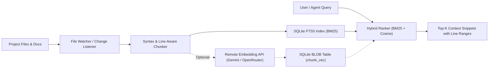
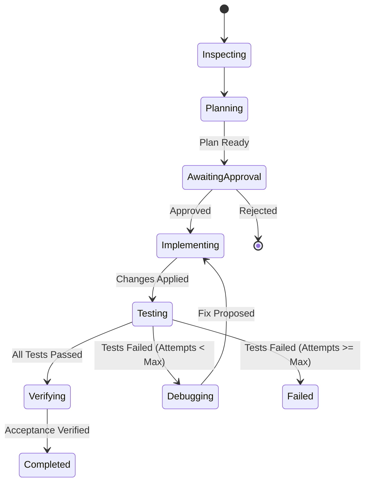

# 08 — Project Intelligence: RAG, Code Graph, Memory & Loop Engineering

> This document specifies the lightweight, resource-conscious intelligence layer of MindSparQ Jarvis, designed to run smoothly on constrained devices (10 GB RAM laptops and Android phones) without heavy external vector or graph databases.

---

## 1. Retrieval-Augmented Generation (RAG) Architecture

Instead of deploying heavy vector databases that consume 1–2 GB of RAM, Jarvis uses a **hybrid, local-first retrieval system**:

### 1.1 Local Full-Text Search (FTS5) — Primary Engine
- **Engine**: SQLite FTS5 with BM25 ranking algorithm.
- **Tokenization**: `unicode61 remove_diacritics 2`.
- **Chunking**: Code files are chunked along function, class, or 60-line boundaries with a 10-line overlap.
- **Zero Memory Overhead**: Stored within the local SQLite database (`chunk_fts` virtual table). Search times are typically under 15 ms for codebases with up to 100,000 lines.

### 1.2 Optional Semantic Embeddings
- Enabled only when the user configures an embedding API key (e.g. Gemini `text-embedding-004` or OpenRouter embeddings).
- Generated vectors are stored as compressed binary blobs in the `chunk_vec` table.
- Cosine similarity matching is computed in Kotlin native/JVM routines on candidate results filtered by FTS5, preventing full vector table scans.

---

## 2. Code Graph & Dependency Intelligence

The Code Graph models symbols, dependencies, and file relationships to provide impact analysis before an agent edits code.

### 2.1 Indexing Pipeline
1. **Extraction**:
   - **PC Desktop**: Runs `ctags` or `tree-sitter` CLI to produce structured JSON output.
   - **Android**: Executes `universal-ctags` inside the PRoot environment.
2. **Schema**:
   - `symbol`: Records name, kind (`CLASS`, `FUNCTION`, `INTERFACE`, `VARIABLE`), file path, line number, and scope.
   - `edge`: Records relationships (`IMPORTS`, `CALLS`, `INHERITS`, `TESTS`).
3. **Change-Impact Analysis**:
   - When a file modification is proposed, Jarvis executes a breadth-first search (BFS) on reverse-dependency edges up to depth 3.
   - The agent and the user are presented with a list of impacted files and associated unit tests that must be executed after the edit.

---

## 3. Project Memory Architecture

Project Memory prevents conversational amnesia and avoids redundant context transmission across sessions.

### 3.1 Memory Classification
| Category | Table Kind | Description | Example |
|---|---|---|---|
| **Fact** | `FACT` | Core project invariants | "Backend runs on FastAPI with SQLite" |
| **Decision** | `DECISION` | Architectural decisions (ADRs) | "Use JWT in HttpOnly cookies, no local storage" |
| **Task State** | `TASK_STATE` | Status of in-progress tasks | "Step 2 completed: Auth endpoint created" |
| **Known Issue** | `KNOWN_ISSUE` | Bugs or environmental quirks | "Port 8080 busy on device, use 8081" |
| **Preference** | `PREFERENCE` | User-defined coding rules | "Prefer sealed classes over open inheritance" |

### 3.2 Rules of Memory
- **Inspectable & Editable**: Users can view, edit, add, or delete any memory item in the **Settings › Memory** screen or via the `/memory` command.
- **Strictly Redacted**: Secrets, authentication tokens, and private keys are never persisted in memory tables.
- **Context Budget**: Memory items are injected into the agent's context window capped at a maximum of 1,500 tokens.

---

## 4. Bounded Loop Engineering

To ensure the AI agent does not loop indefinitely, make unchecked claims, or produce broken code, Jarvis enforces an explicit **Test–Debug–Repair State Machine**.

### 4.1 Loop Constraints
- **Max Steps**: Default 60 steps per task.
- **Max Repair Attempts**: Capped at 3 retry loops on failing tests. If still failing after 3 attempts, the task halts with a `FAILED` status and produces a diagnostic bug report.
- **No Evidence, No Completion Claim**: An agent cannot mark a task `COMPLETED` unless:
  1. The project builds with exit code 0.
  2. Targeted unit/regression tests produce genuine passing output.
  3. A Git diff of the modifications is recorded in the evidence store.

