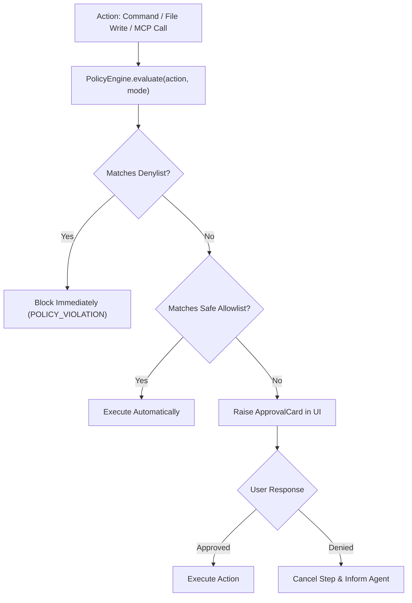

# 09 — Security Architecture & Threat Model

> MindSparQ Jarvis executes arbitrary code, invokes external AI models, and automates builds. This document establishes the security boundaries, policy controls, and secret management mechanisms to ensure safe operation.

---

## 1. Threat Model & Platform Realities

### 1.1 Android PRoot Environment
- **Not a Security Sandbox**: PRoot is an unprivileged userspace emulation layer. It does not provide kernel-level virtualization or hardware isolation. Any process running inside PRoot shares the UID and Linux permissions of the Android host application.
- **Defense in Depth**:
  - API keys and user credentials are **never written** to the PRoot filesystem.
  - The Android Keystore holds all encryption keys; credentials reside in the host Android process memory only when dispatching an authenticated network call.

### 1.2 Desktop Host Shell
- On Linux, Windows, and macOS, commands execute within the user's desktop shell.
- Dangerous command patterns (e.g., `rm -rf /`, `mkfs`, format commands, modifying system boot records or registry) are explicitly intercepted and hard-denied by the `PolicyEngine`.

---

## 2. PolicyEngine & Approval Gates

Every tool call generated by an AI model or user action passes through the centralized `PolicyEngine` before execution.

### 2.1 Operating Modes
1. **Ask Mode**: Read-only operations allowed (file reads, searches, directory listings). All commands, file edits, and network dispatches are blocked.
2. **Plan Mode**: Read-only file inspection permitted; file writing is restricted strictly to documentation under the project's `docs/` directory. No source code modifications or execution of external commands allowed.
3. **Work Mode**: Modifications and command executions permitted, subject to the configured approval level:
   - `STRICT` (Default): Every file modification, git write, and shell command requires explicit user confirmation.
   - `RELAXED`: File edits and safe commands (e.g., test runners, linters, git status) auto-approved; destructive actions (deletions, git force-push, package installation) still require confirmation.

---

## 3. Secret Management & Zero-Plaintext Rule

1. **Android**: Uses `ApiKeyVault` backed by the **Android Keystore System** using AES-256-GCM authenticated encryption.
2. **Desktop**: Uses the system credential store (Linux `SecretService`/libsecret, Windows `CredentialManager`, macOS `Keychain`) via `java-keyring`.
3. **Redaction Engine**: All outgoing stdout/stderr streams, terminal logs, diagnostic bundles, and AI message histories pass through a stream redactor that masks:
   - Google Gemini keys (`AIza[0-9A-Za-z-_]{35}`)
   - OpenAI / OpenRouter keys (`sk-[0-9A-Za-z-_]{32,}`)
   - Anthropic keys (`sk-ant-[0-9A-Za-z-_]{32,}`)
   - GitHub Personal Access Tokens (`ghp_[0-9A-Za-z]{36}`)
   - HTTP `Authorization: Bearer ...` headers

---

## 4. Safe File Extraction & Archive Handling

When importing external project archives (ZIP / TAR):
- **Path Traversal Protection**: Rejects any archive entry containing `../` or absolute destination paths (Zip-Slip defense).
- **Symlink Jailing**: Symlinks pointing outside the designated project workspace root are discarded or converted into regular zero-byte files.
- **Resource Limits**: Archive decompression is capped at a maximum of 2 GB uncompressed volume and 100,000 files to prevent decompression bombs (zip bombs).

---

## 5. Android Package Installation Security

1. **No Silent Installs**: Jarvis never attempts to silently install APKs or bypass OS-level installation guards.
2. **Official API Handoff**: Completed APK builds are handed off directly to Android's official `PackageInstaller` session API, requiring the user to explicitly grant permission on the native system dialog.
3. **Integrity Verification**: The SHA-256 checksum and package metadata (version code, package name) are validated and displayed to the user prior to launching the system installer.

