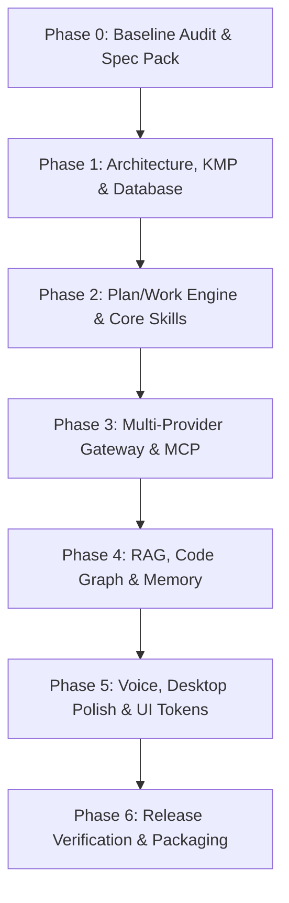

# 11 — Implementation Plan: Step-by-Step Roadmap

> This document defines the dependency-aware execution roadmap for transforming the baseline into **MindSparQ Jarvis**.

---

## 1. Roadmap Overview

---

## 2. Phase Breakdown

### Phase 0: Baseline Audit & Spec Pack (Current)
- **Goal**: Complete architectural audit of Mobile-Harness, establish the Spec Pack in `Docs/specs/`, create agent prompts, and verify the existing codebase baseline.
- **Deliverables**: All 14 spec documents in `Docs/specs/`, copy-paste prompts in `Docs/specs/prompts/`, and baseline test execution.
- **Exit Criteria**: Baseline tests pass; Spec Pack fully committed and verified.

---

### Phase 1: Clean Architecture, KMP Setup & Relational DB
- **Goal**: Transition from single-module Android monolith to modular Kotlin Multiplatform (KMP) architecture; replace flat JSON storage with SQLDelight; rebrand to `com.mindsparq.jarvis`.
- **Tasks**:
  1. Initialize KMP Gradle build logic and module structure (`core`, `engine`, `ai`, `feature`, `apps`).
  2. Implement SQLDelight database with tables for projects, chats, tasks, evidence, providers, keys, and models.
  3. Deconstruct `PocketDevApp.kt` and `MainViewModel.kt` into dedicated feature view models and composables.
  4. Port native PRoot runtime scripts and JNI bridges into `apps/android` and `core/runtime`.
- **Exit Criteria**: All 98 original unit tests pass; projects and sessions persist across app restarts in SQLite; zero files exceeding 1,500 lines of code.

---

### Phase 2: Plan/Work Engine, Loop State Machine & Core Skills
- **Goal**: Implement structured execution modes (Ask / Plan / Work), the bounded test-debug-repair loop, and the Agent Skills standard.
- **Tasks**:
  1. Implement `TaskOrchestrator` state machine (`QUEUED` → `INSPECTING` → `PLANNING` → `IMPLEMENTING` → `TESTING` → `COMPLETED`).
  2. Build `ApprovalCard` UI flow for diff inspection and command execution gating.
  3. Integrate test discovery and output parsing (JUnit, Pytest, Vitest, Flutter test).
  4. Bundle the 10 initial core skills in `skills/` and implement the `SkillManager`.
- **Exit Criteria**: Scenarios C and G pass on test devices; tests produce parsed evidence; skills can be enabled/disabled per project.

---

### Phase 3: AI Gateway, Multi-Key Pool & MCP Integration
- **Goal**: Build the provider-neutral AI Gateway with multi-key rotation, daily free-model discovery, and MCP client support.
- **Tasks**:
  1. Implement `LlmProvider` adapters for Gemini (v1beta SSE), OpenRouter (OpenAI chat compat), Ollama (NDJSON), and Anthropic.
  2. Implement `KeyPool` with cooldown timers, LRU selection, and daily quota reset management.
  3. Implement `ModelCatalog` with background daily sync of OpenRouter `:free` open-source models and Gemini version ranking.
  4. Integrate the official Kotlin MCP SDK (`io.modelcontextprotocol:kotlin-sdk`) and implement the MCP Server Manager UI.
  5. Add config sync to export `.mcp.json` for external CLI agents (Claude Code, Antigravity `agy`).
- **Exit Criteria**: Scenarios D and L pass; simulated 429 quota exhaustion switches keys without context loss; MCP servers discover and invoke tools.

---

### Phase 4: Project Intelligence: RAG, Code Graph & Memory
- **Goal**: Enable efficient retrieval and codebase relationship mapping without high RAM consumption.
- **Tasks**:
  1. Implement SQLite FTS5 chunked indexer with background file change listener.
  2. Implement ctags/tree-sitter extraction pipeline into `symbol` and `edge` tables.
  3. Build `ChangeImpactAnalyzer` to calculate affected components and tests before code edits.
  4. Implement `ProjectMemoryStore` with user-editable facts, decisions, and preferences.
- **Exit Criteria**: Scenario F passes; search queries return exact file paths and line ranges; code edits trigger incremental index refreshes.

---

### Phase 5: Voice Dictation, Desktop Host & Obsidian Kinetic UI
- **Goal**: Implement speech-to-text integration, Desktop host capabilities, and complete UI styling following Obsidian Kinetic design tokens.
- **Tasks**:
  1. Integrate platform voice dictation (Android `SpeechRecognizer` with Nepali/English support; Desktop audio transcription).
  2. Implement Desktop host execution (native process spawning, PTY via `pty4j`).
  3. Apply Obsidian Kinetic theme tokens (`#07090E` obsidian background, electric cyan accents, Inter & JetBrains Mono typography).
  4. Implement responsive layouts (Compact single-pane on phones; Expanded 3-region workspace on Desktop).
- **Exit Criteria**: Scenario K passes; Desktop runs host terminal and builds; phone dictation inserts transcribed text into the composer; contrast checks pass.

---

### Phase 6: Security Audit, Packaging & Release Verification
- **Goal**: Verify end-to-end security policies, sign release binaries, and generate self-contained distributions.
- **Tasks**:
  1. Perform full security audit against OWASP ASVS and verify `PolicyEngine` path jailing.
  2. Build signed Android APK and verify on real physical device via `PackageInstaller`.
  3. Package Desktop distributions (Linux `.deb` & AppImage, Windows `.msi`, macOS `.dmg`).
  4. Write comprehensive user documentation and migration guides.
- **Exit Criteria**: All 12 Acceptance Scenarios (A–L) produce verified evidence; clean release builds generated for Android and Desktop.

