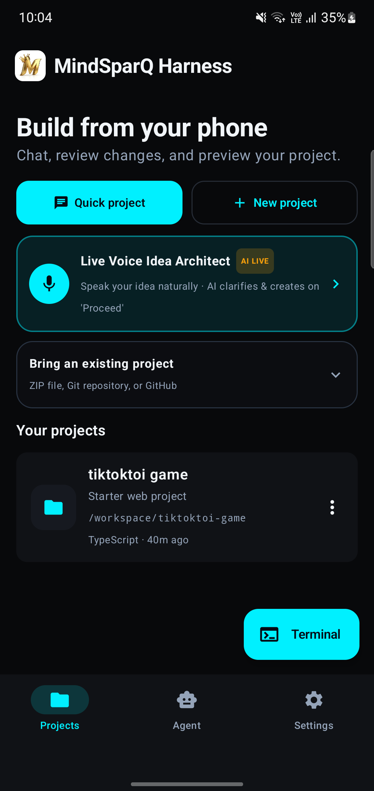
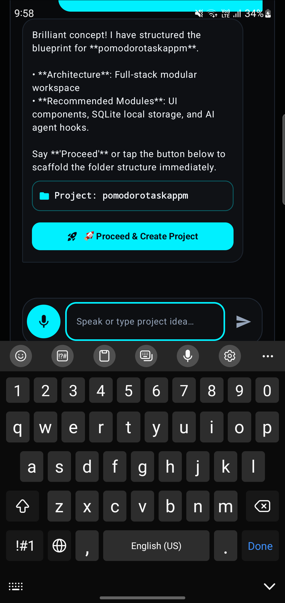
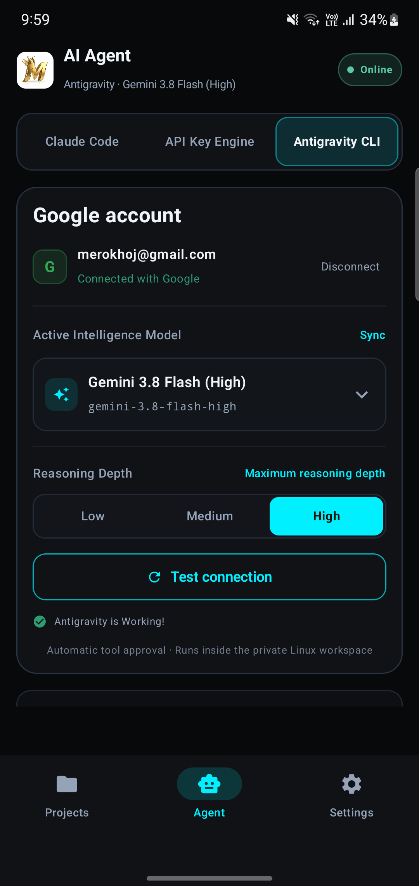
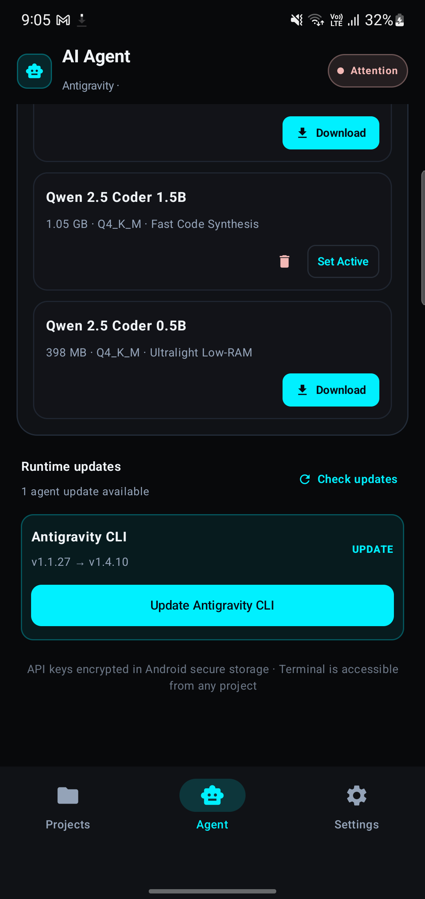
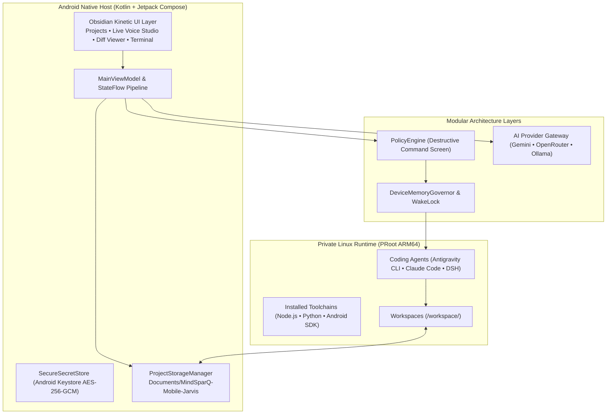

<div align="center">

  

  # MindSparQ Harness

  ### *The Autonomous Mobile AI Coding Studio & Jarvis Engineering Partner*

  **Converse with your AI architect, clarify product ideas, generate complete PRD & TRD blueprints, run offline models, and build real applications directly on your phone.**

  <br />

  [](https://github.com/roadofriot/MindSparQ-Mobile-Jarvis/releases)
  [](#system-requirements)
  [](#system-requirements)
  [](LICENSE)
  [](#offline-slm-studio)

  <br />

  [**Download Latest APK**](https://github.com/roadofriot/MindSparQ-Mobile-Jarvis/releases) &nbsp;•&nbsp;
  [**Live Voice Architect**](#1-live-voice-idea-architect) &nbsp;•&nbsp;
  [**Multi-Engine AI**](#3-universal-multi-model-engine) &nbsp;•&nbsp;
  [**Architecture**](#architecture) &nbsp;•&nbsp;
  [**Build from Source**](#building-from-source)

</div>

<br />

---

## What is MindSparQ Harness?

MindSparQ Harness turns your Android phone into an autonomous development workstation. It pairs an isolated Linux userspace (PRoot) with a native Jetpack Compose interface, allowing you to converse with an AI architect, execute shell tools, preview local web servers, and compile native Android apps directly on device.

All generated projects are automatically mirrored to your public **`Documents/MindSparQ-Mobile-Jarvis/`** directory, making your source code, PRDs, and builds accessible from Samsung My Files, Google Files, or a PC via USB.

<br />

---

## Visual Tour

<div align="center">
  <table>
    <tr>
      <th width="50%" align="center">Dashboard & Brand Identity</th>
      <th width="50%" align="center">Live Voice Idea Architect</th>
    </tr>
    <tr>
      <td align="center"></td>
      <td align="center"></td>
    </tr>
    <tr>
      <td align="center"><sub>3D Golden Crown emblem, quick projects, and active workspaces.</sub></td>
      <td align="center"><sub>Two-way spoken voice dialog, requirement clarification, and PRD/TRD generator.</sub></td>
    </tr>
    <tr>
      <th width="50%" align="center">Multi-Model & Provider Gateway</th>
      <th width="50%" align="center">Offline SLM & Hardware Profiler</th>
    </tr>
    <tr>
      <td align="center"></td>
      <td align="center"></td>
    </tr>
    <tr>
      <td align="center"><sub>Gemini, OpenRouter, DeepSeek, and Antigravity with auto-fallback.</sub></td>
      <td align="center"><sub>Real GGUF models, hardware recommendations, and cache cleaner.</sub></td>
    </tr>
  </table>
</div>

<br />

---

## Core Capabilities

### 1. Live Voice Idea Architect
- **Two-Way Voice Conversation**: Speak naturally to Jarvis using built-in Android Speech-to-Text and spoken Text-to-Speech (TTS).
- **Intelligent Clarification**: Jarvis asks targeted questions about your target audience, platform, UI styling, and storage layer.
- **Two-Stage Autonomous Scaffolding**:
  1. **Plan Proposal**: Formulates a complete Product Requirements Document (`PRD.md`), Technical Requirements Document (`TRD.md`), and System Architecture (`ARCHITECTURE.md`).
  2. **Build Execution**: Saying *"Proceed"* or tapping the build trigger provisions the project folder and opens the workspace.

### 2. User-Accessible File Manager Storage
- Projects are automatically mirrored to:
  ```text
  /storage/emulated/0/Documents/MindSparQ-Mobile-Jarvis/<project_name>/
  ```
- Instant access via any Android file manager (Samsung My Files, Google Files, Solid Explorer) or USB/MTP connection without root access.
- One-tap **"Open in File Manager"** action directly from the project menu.

### 3. Universal Multi-Model Engine
- **Cloud & Open Models**: Native support for Google Gemini 2.5/3.x, OpenRouter free models, DeepSeek, Ollama, NVIDIA NIM, and Claude Code.
- **Auto-Failover Pool**: Register multiple API keys per provider. When rate limits (HTTP 429) or token quotas are reached, requests automatically transfer to healthy keys.
- **Android Keystore Security**: All API keys and secrets are encrypted with AES-256-GCM hardware protection.

### 4. Offline SLM Studio
- **Curated Open Weights**: Download real HuggingFace GGUF models (Qwen2.5-Coder-0.5B, Smaug-Llama-3-8B, Gemma-2-2B, etc.).
- **Resumable HTTP Downloads**: Supports connection breaks with HTTP `Range` headers and live Mbps speed calculation.
- **Dynamic Device Profiling**: Analyzes RAM, CPU cores, and storage to recommend models tailored for your device (e.g. 12GB RAM flagship vs 4GB/6GB devices).
- **One-Tap Cache Cleaner**: Reclaims disk space by purging temporary compiler artifacts and HTTP caches.

### 5. Crash-Proof Background Execution
- Built with an Android `ForegroundService` and `PARTIAL_WAKE_LOCK` to ensure builds, package installations, and agent reasoning tasks continue reliably when the screen is locked or while switching apps.

### 6. Mobile Coding Keyboard & Interactive Diff Review
- **Shortcut Strips**: Persistent coding keys above the keyboard (`Tab`, `Ctrl`, `Esc`, `↑`, `↓`, `|`, `/`, `~`, `$`, `"`, `'`, `{`, `}`, `git`).
- **Side-by-Side Diff Viewer**: Real-time git changes tab with single-tap file rollback (`Undo`) or acceptance (`Keep`).

<br />

---

## Architecture

MindSparQ Harness pairs a high-performance native Kotlin/Compose host with an isolated PRoot Linux execution layer:



<br />

---

## System Requirements

| Specification | Minimum | Recommended |
| :--- | :--- | :--- |
| **Operating System** | Android 9.0 (API 28) | Android 12.0+ |
| **CPU Architecture** | ARM64 (`arm64-v8a`) | 8-core ARM64 |
| **RAM** | 4 GB | 8 GB – 12 GB |
| **Available Storage** | 4 GB free space | 15 GB+ (for offline models and toolchains) |

<br />

---

## Building from Source

### Prerequisites
- JDK 17 or higher
- Android SDK (API 34, Build Tools 34.0.0, NDK 26+)
- Linux (Ubuntu 22.04+ recommended) or macOS

### Build Commands
```bash
# Clone the repository
git clone https://github.com/roadofriot/MindSparQ-Mobile-Jarvis.git
cd MindSparQ-Mobile-Jarvis

# Run unit tests
./gradlew testDebugUnitTest --no-daemon --max-workers=2 -Dorg.gradle.jvmargs="-Xmx1536m"

# Assemble signed debug APK
./gradlew :app:assembleOnlineDebug --no-daemon --max-workers=2 -Dorg.gradle.jvmargs="-Xmx1536m"

# Output APK path
# app/build/outputs/apk/online/debug/app-online-debug.apk
```

<br />

---

## License

This project is licensed under the [MIT License](LICENSE). Third-party subcomponents and licenses are documented in [`app/src/main/assets/licenses/`](app/src/main/assets/licenses/).
