# MindSparQ Mobile Jarvis — Current System Architecture

**Document Version:** 1.0.0 Enterprise Audit  
**Target Application:** MindSparQ Mobile Jarvis (`com.mindsparq.jarvis`)  
**Target Platforms:** Android (ARM64-v8a PRoot), Linux Desktop, Web  
**Primary Test Host:** Samsung Galaxy Note 10+ SCV45 (12 GB RAM, ARM64-v8a)  
**Host Development Environment:** Ubuntu Linux (Intel i3-1005G1, 10 GB RAM)

---

## 1. System Overview & Dual Architectural Topology

MindSparQ Mobile Jarvis currently contains a **hybrid dual topology**:

```mermaid
graph TD
    subgraph UI_And_Legacy_App [App Module - com.jarves.mh]
        UI[Compose UI: PocketDevApp & AgentScreen]
        VM[MainViewModel - 5800+ LOC]
        Vault[ApiKeyVault - Keystore AES-GCM]
        Pref[AppPreferences - SharedPreferences]
        Gateways[LocalFormatGateway & OpenRouterGateway]
        Bridges[ClaudeBridge, DshBridge, AntigravityBridge]
        PRoot[PRoot Linux Runtime - Alpine/Debian Userspace]
    end

    subgraph Enterprise_Modules [Modular Layers - com.mindsparq.jarvis]
        CoreModel[core:model - Domain Models & Enums]
        CoreDB[core:database - SQLDelight JarvisDatabase]
        CorePolicy[core:policy - PolicyEngine & SecureSecretStore]
        CoreDesign[core:designsystem - Material3 Design System]
        CoreRuntime[core:runtime - DeviceMemoryGovernor & ProcessRunner]
        AiGatewayMod[ai:gateway - KeyPoolManager & AiGateway]
        AiSkillsMod[ai:skills - SkillManager & Discovery]
        AiMcpMod[ai:mcp - McpConfigExporter]
        EngineLoop[engine:loop - TaskOrchestrator & State]
        EngineVoice[engine:voice - VoiceService]
        EngineIndex[engine:index - FtsIndexManager]
        EngineGraph[engine:graph - ChangeImpactAnalyzer]
        EngineMem[engine:memory - ProjectMemoryStore]
        EngineTest[engine:test - TestResultParser]
    end

    UI --> VM
    VM --> Vault
    VM --> Bridges
    VM --> AiGatewayMod
    VM --> CoreModel
    VM --> CoreDB
    VM --> CorePolicy
    Bridges --> PRoot
    Bridges --> Gateways
```

1. **The Modular Enterprise Layer (`com.mindsparq.jarvis.*`)**:
   - Clean Kotlin Multiplatform / Android modular architecture consisting of `:core:model`, `:core:database`, `:core:policy`, `:core:designsystem`, `:core:runtime`, `:ai:gateway`, `:ai:skills`, `:ai:mcp`, `:engine:loop`, `:engine:voice`, `:engine:memory`, `:engine:index`, `:engine:graph`, and `:engine:test`.
   - Uses SQLDelight for SQLite relational persistence (`JarvisDatabase.sq`), encrypted keystore-backed security (`AndroidKeystoreSecretStore`), deterministic policy filtering (`PolicyEngine`), multi-key pool rotation (`KeyPoolManager`), and structured state-machine orchestration (`TaskOrchestrator`).
2. **The Active Runtime & UI Layer (`com.jarves.mh.*` in `:app`)**:
   - Houses the fully functional production Android UI (`PocketDevApp.kt`, `UnifiedAiProviderSheet.kt`, `SettingsScreenModern.kt`, `LiveVoiceProjectArchitect.kt`), Android foreground execution services, and native PRoot Linux guest virtualization bridges (`DshRuntimeBridge`, `ClaudeRuntimeBridge`, `AntigravityRuntimeBridge`).
   - Employs `ApiKeyVault` (AES-256-GCM backed by Android Keystore), `WorkspaceCheckpoints` for file snapshotting/reversals, and loopback socket proxies (`LocalFormatGateway`, `OpenRouterRoutingGateway`).

---

## 2. 24-Point Comprehensive Architectural Breakdown

### 1. Android Application Architecture
- **Application Class**: Initialized via Jetpack Compose single-activity model (`MainActivity.kt`).
- **Activity / Window Handling**: Edge-to-edge UI with Android IME keyboard insets (`imePadding()`), hardware keep-screen-on toggles during AI generation tasks, and responsive layout adaptions.
- **Service Layer**: `RuntimeExecutionService` (foreground service with persistent notification) and `RuntimeSetupService` (tar extraction / bootstrap runner).

### 2. Gradle Modules and Dependencies
- **Gradle Version**: 8.14 with Android Gradle Plugin (AGP) 8.9.x.
- **Build Configurations**: Online Debug, Offline Debug, Release.
- **Module Graph**:
  - `:app` depends on `:core:model`, `:core:database`, `:core:policy`, `:core:designsystem`, `:engine:voice`, `:ai:gateway`.
  - Leaf modules enforce strict boundary separation: `core` and `ai` modules never import feature or UI packages.

### 3. AgentRegistry Implementation
- **Location**: `app/src/main/java/com/jarves/mh/runtime/AgentDriver.kt`
- **Capabilities**: Dynamically registers drivers for `AgentKind.CLAUDE_CODE`, `AgentKind.DEEPSEEK_HARNESS`, and `AgentKind.ANTIGRAVITY`.
- **Capability Flags**: `API_KEY`, `ACCOUNT_LOGIN`, `PROVIDER_PICKER`, `MODEL_PICKER`, `REASONING_EFFORT`, `RESUME`, `INTERACTIVE_APPROVALS`.

### 4. AgentDriver Implementation
- Provides runtime lifecycle abstraction (`install()`, `isInstalled()`, `runtime`, `capabilities`).
- Wraps concrete CLI bridges without exposing subprocess details to Compose composables.

### 5. TaskOrchestrator Implementation
- **Location**: `engine/loop/src/main/java/com/mindsparq/jarvis/engine/loop/TaskOrchestrator.kt`
- **States**: `QUEUED`, `INSPECTING`, `PLANNING`, `AWAITING_APPROVAL`, `IMPLEMENTING`, `TESTING`, `DEBUGGING`, `VERIFYING`, `COMPLETED`, `FAILED`, `CANCELLED`, `BLOCKED`.
- **Evidence Collection**: Records diffs, tool executions, test outputs, and approval verdicts.

### 6. AiGateway Implementation
- **Location**: `ai/gateway/src/main/java/com/mindsparq/jarvis/ai/gateway/AiGateway.kt`
- **Flow**: Multi-provider fallback chain with automatic rate-limit cooldown management (`KeyPoolManager`) and event streaming (`ChatResponseEvent`).

### 7. ProviderRegistry Implementation
- **Location**: `app/src/main/java/com/jarves/mh/model/Models.kt` (`ProviderKind`) & `JarvisDatabase.sq` (`provider` table).
- **Supported Providers**: `GEMINI`, `LLM_ROUTER` (OpenRouter), `OLLAMA` (Local / Offline), `NVIDIA_NIM`, `DEEPSEEK`, `OPENCODE_ZEN`, `ANTHROPIC`, `CLAUDE`, `KIMI`, `CUSTOM`.

### 8. ModelRegistry Implementation
- **Static Catalogs**: `OfflineModelManager` (GGUF catalog), `ModelCatalog` (NVIDIA NIM and OpenRouter free models).
- **Dynamic Catalogs**: `ProviderApiClient.discoverModels()` queries `/v1/models` and provider endpoints.

### 9. ClaudeRuntimeBridge
- **Execution Protocol**: Streams JSON-RPC lines (`stream-json`) over PRoot stdin/stdout to `/usr/local/bin/claude`.
- **Adapter**: Uses `LocalFormatGateway` when running OpenAI-compatible providers through Claude Code.

### 10. DshRuntimeBridge
- **Execution Protocol**: Interacts with `/usr/local/bin/dsh --profile sdk` via newline-delimited JSON-RPC.
- **Routing**: Generates guest `settings.yaml` pointing to OpenAI completions or Anthropic messages endpoints.

### 11. AntigravityRuntimeBridge
- **Execution Protocol**: Directly invokes `/usr/local/bin/agy` with Google OAuth token or Google Cloud credentials.
- **Limitation**: Only supports Google account authentication; does not support third-party OpenAI endpoints.

### 12. RuntimeInstaller
- **Location**: `app/src/main/java/com/jarves/mh/runtime/RuntimeInstaller.kt`
- **Responsibilities**: Bootstraps the rootfs (Debian/Alpine arm64-v8a), extracts Node.js / Python / Git environments, configures symlinks, repairs dynamic linker headers, and manages independent agent CLI packages.

### 13. ProviderApiClient
- **Location**: `app/src/main/java/com/jarves/mh/network/ProviderApiClient.kt`
- **Features**: Live model discovery, ping latency validation, endpoint probe, and error message sanitization.

### 14. OpenRouterRoutingGateway
- **Location**: `app/src/main/java/com/jarves/mh/runtime/OpenRouterRoutingGateway.kt`
- **Features**: Local HTTP loopback socket server that injects custom routing order arrays (`order`, `allow_fallbacks`) into Anthropic messages requests destined for OpenRouter.

### 15. LocalFormatGateway
- **Location**: `app/src/main/java/com/jarves/mh/runtime/LocalFormatGateway.kt`
- **Features**: Translates Anthropic messages API payloads (`/v1/messages`) to OpenAI chat completions (`/v1/chat/completions`) in real-time, enabling OpenAI-only providers to power Claude Code.

### 16. PolicyEngine
- **Location**: `core/policy/src/main/java/com/mindsparq/jarvis/core/policy/PolicyEngine.kt`
- **Features**: Evaluates shell commands against hard-deny patterns (`rm -rf /`, `mkfs`, `dd`, `shutdown`), allowlists (`git`, `ls`, `./gradlew test`), and execution modes (`ASK`, `PLAN`, `WORK`).

### 17. Authentication and Authorization
- **OAuth Device Flow**: Implemented for GitHub (`GitHubClient.kt`) with auto-filling URLs (`?user_code=XXXX`) and background token polling.
- **Google OAuth**: Managed by `AntigravityAuthController` for Antigravity CLI sign-in.
- **Claude Setup Token**: Token-based subscription authentication.

### 18. API Key Management
- **Security Storage**: `ApiKeyVault` in `:app` (AES-256-GCM via Android Keystore) and `AndroidKeystoreSecretStore` in `:core:policy`.
- **Multi-Key Pooling**: `KeyPoolManager` in `:ai:gateway` supports multiple active/cooling/exhausted keys per provider with LRU selection.

### 19. Database and Persistence
- **Relational Schema**: SQLDelight SQLite (`JarvisDatabase.sq`) supporting `project`, `chat`, `message`, `task`, `evidence`, `provider`, `api_key`, `model`, `mcp_server`.
- **Key-Value State**: EncryptedSharedPreferences (`pocket_secrets`) and regular SharedPreferences (`pocket_dev_prefs`).

### 20. Voice Interaction Pipeline
- **Dual Flow**:
  1. `GeminiLiveVoiceClient.kt`: Direct conversational dialogue with Gemini 2.5 Flash / OpenRouter for requirements discovery and project planning.
  2. `VoiceService.kt` + Android `RecognizerIntent`: Speech-to-text dictation and TTS feedback in Nepali (`ne-NP`) and English (`en-US`).

### 21. Android Automation
- **Location**: `app/src/main/java/com/jarves/mh/runtime/AndroidBuildSupport.kt` & `AndroidAppInstaller.kt`.
- **Capabilities**: Local Gradle builds inside PRoot (`./gradlew assembleDebug`), APK parsing, automatic package install intents, logcat capture, and diagnostic error classification.

### 22. Terminal and Command Execution
- **Location**: `TerminalScreen.kt` & `NativeSpawnProcess.kt`.
- **Virtual Terminal**: Pseudo-terminal (PTY) emulation via native `pocketspawn` shared library with ANSI color escape code rendering, process signal controls (`SIGINT`, `SIGKILL`), and background streaming.

### 23. Error Handling and Fallback Mechanisms
- **Current State**:
  - `AiGateway` has programmatic key rotation and provider fallback.
  - `MainViewModel` provides auto-fallback across saved providers when rate limits occur.
  - Runtime bridges classify errors into user-actionable diagnostics.

### 24. Existing Tests and Build Configuration
- **Test Suite**: 222 unit tests passing across all modules (`:ai:gateway`, `:core:database`, `:core:policy`, `:core:runtime`, `:engine:loop`, `:engine:voice`, `:app`).
- **Execution Constraints**: Gradle flags `--no-daemon --max-workers=2 -Dorg.gradle.jvmargs="-Xmx1536m"` enforced for resource-constrained Intel i3 / 10GB host.

